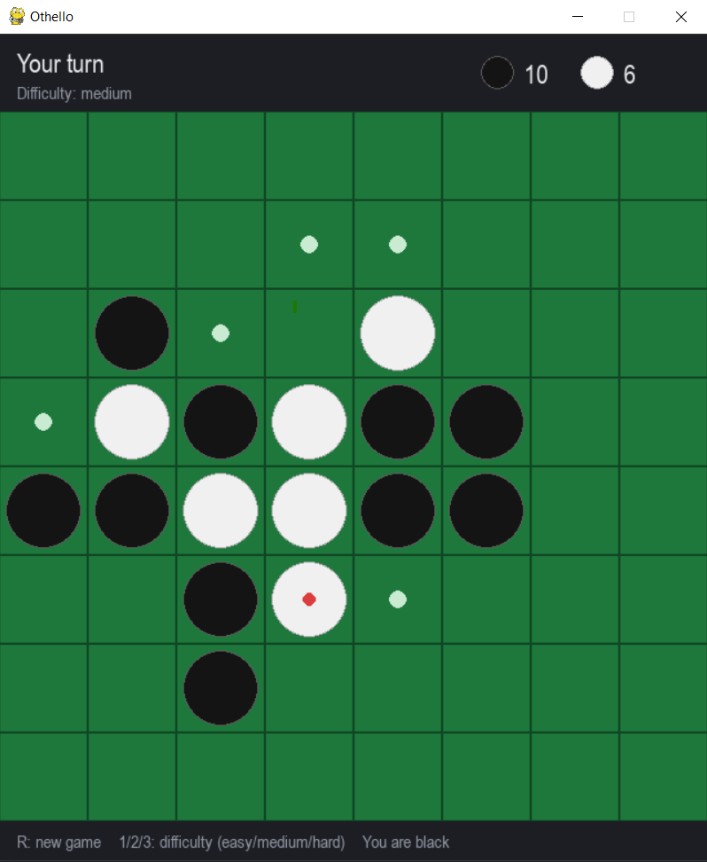

# Othello AI

An Othello (Reversi) opponent built on **negamax search with alpha-beta pruning**,
with a small pygame interface to play against it. The interesting part of this
project is the search in [`othello/ai.py`](othello/ai.py); the game around it
is intentionally minimal.

<p align="center">
  
</p>

## How the AI works

### 1. Minimax and negamax

Othello is a two-player, zero-sum game: whatever is good for one player is
equally bad for the other. Minimax exploits this by searching the game tree
and assuming both sides play their best move. The maximizing player picks the
highest value, the minimizing player picks the lowest.

**Negamax** is the same algorithm written once instead of twice. Because
`max(a, b) = -min(-a, -b)`, we can always score a position from the point of
view of the player to move, and negate the result when we go one level deeper:

```python
def negamax(board, player, depth, alpha, beta):
    if depth == 0:
        return evaluate(board, player)
    best = -inf
    for move in legal_moves(board, player):
        value = -negamax(play(board, move), -player, depth - 1, -beta, -alpha)
        best = max(best, value)
        alpha = max(alpha, best)
        if alpha >= beta:
            break          # prune
    return best
```

Since the sign flip is built into the recursion, there is no
`maximizing_player` flag to get wrong.

### 2. Alpha-beta pruning

Plain minimax visits every node down to the search depth. Alpha-beta keeps two
bounds while searching:

- `alpha`: the best value the current player is already guaranteed
- `beta`: the best value the opponent will allow

When `alpha >= beta`, the opponent would never let the game reach this position,
so the remaining sibling moves are skipped. The result is **identical to full
minimax**, but far fewer nodes are visited.

**Move ordering** makes pruning much more effective: moves are tried in order
of their square weight (corners first), so strong moves raise `alpha` early and
cut off more of the tree.

### 3. Evaluation function

At the search horizon, positions are scored by a heuristic
(`evaluate` in `ai.py`), from the point of view of the player to move:

| Term | What it captures |
|------|------------------|
| **Positional weights** | A static 8x8 table: corners are worth a lot (+100), the squares next to corners are dangerous (-20, -50) because they give the opponent a corner, edges are mildly good. |
| **Mobility** | `8 * (my legal moves - opponent legal moves)`. Having more options than the opponent is one of the strongest signals in Othello. |
| **Disc difference (endgame)** | Counting discs is a poor heuristic early on (fewer discs is often better), but when 8 or fewer squares are empty it is weighted in (`10 * diff`). |

### 4. Terminal positions and passes

- If a player has **no legal move** but the opponent does, the player passes:
  the search continues with the opponent to move and **does not consume depth**.
- If **neither** player can move, the game is over and the position gets an exact
  score: `±10000` plus the final disc difference, so a win always outranks any
  heuristic value, and bigger wins are preferred.

### 5. Difficulty

Difficulty is just the search depth (plies looked ahead):

| Level | Depth |
|-------|-------|
| easy | 2 |
| medium | 4 |
| hard | 5 |

The search runs in a background thread so the UI stays responsive. On a
typical machine, depth 5 takes well under a second in the opening and around a
second in the midgame.

### Ideas for improvement

- Iterative deepening with a time limit instead of a fixed depth
- Transposition table to avoid re-searching identical positions
- Bitboard representation for much faster move generation
- Stability and frontier-disc terms in the evaluation
- Solving the endgame exactly (search to the end when few squares remain)

## Running it


You play black and move first. Green dots show your legal moves.

| Input | Action |
|-------|--------|
| Left click | Place a disc |
| `R` | New game |
| `1` `2` `3` | Difficulty: easy / medium / hard |
| `Esc` | Quit |

## Tests

```bash
python -m unittest discover -s tests
```

The tests cover move generation, flipping, passing, game-over detection and
the AI (legal moves only, takes an available corner, AI-vs-AI games terminate).

## Project layout

```
main.py            entry point
othello/logic.py   board, rules, turn/pass/game-over handling
othello/ai.py      negamax + alpha-beta, evaluation function
othello/gui.py     pygame interface
tests/             unit tests
docs/              screenshot used in this README
```

